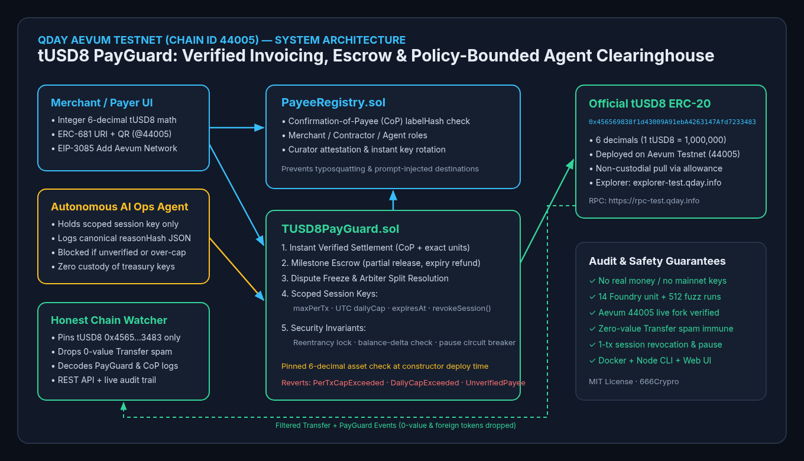
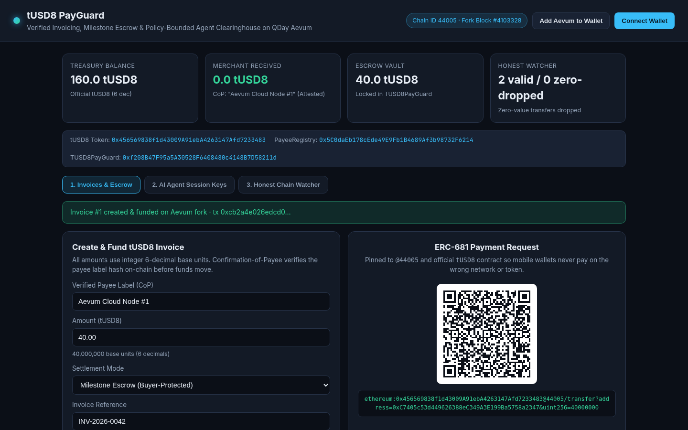
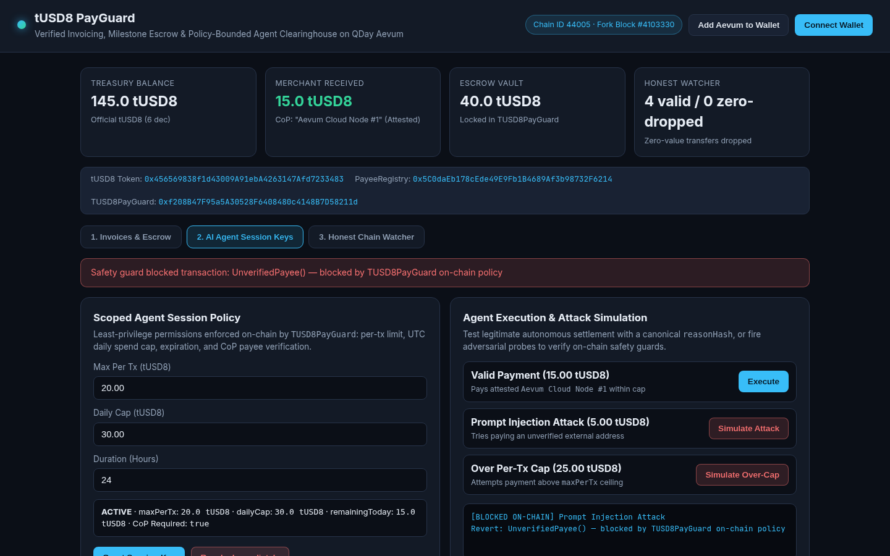
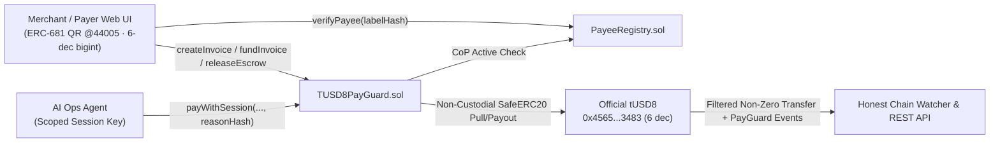

# tUSD8 PayGuard

**Verified Stablecoin Invoicing, Milestone Escrow, Confirmation-of-Payee Registry, and Policy-Bounded AI Agent Clearinghouse on QDay Aevum Testnet (`Chain ID 44005`)**

Built for **Aevum Builder Challenge #1 (QDay)**.



---

## 1. The Problem

Accepting stablecoins in production requires far more than listening for an ERC-20 `Transfer`:

1. **Decimal & network footguns:** `tUSD8` uses **6 decimals** (`1 tUSD8 = 1,000,000` units) while `tQDAY` uses 18. Floating-point math or unpinned ERC-681 URIs cause 10¹²× over/under-payments or cross-network misfires.
2. **Wrong-payee & lookalike spoofing:** Sending `tUSD8` to an unverified `0x` address is irreversible.
3. **Zero-value & spoofed token attacks:** Naive `Transfer` listeners can credit zero-value `Transfer` spam or a lookalike ERC-20 whose `symbol()` returns `"tUSD8"`.
4. **No buyer holdback or safe agent autonomy:** Direct transfers offer zero milestone release/refund protection, while giving an AI procurement agent a raw EOA key exposes the entire treasury to prompt injection or runaway spending.

---

## 2. What We Built

### Smart Contracts (`contracts/src/`)

| Contract | Role | Key Guarantees |
| :--- | :--- | :--- |
| **`PayeeRegistry.sol`** | Confirmation-of-Payee (CoP) & Identity Registry | Stores payee `label`, `labelHash = keccak256(label)`, `PayeeType` (`Merchant`, `Contractor`, `AutonomousAgent`), `metadataURI`, `active` toggle, and optional curator attestation. |
| **`TUSD8PayGuard.sol`** | Non-Custodial Clearinghouse, Milestone Escrow & Agent Session Policy Engine | Pinned at deploy time to 6-decimal `tUSD8` (`0x456569838f1d43009A91ebA4263147Afd7233483`). Supports **Instant CoP Invoices**, **Milestone Escrow** (partial releases, deadline refunds, dispute freeze & arbiter split), and **Scoped Agent Session Keys** (`maxPerTx`, rolling UTC `dailyCap`, `expiresAt`, `requireVerifiedPayee`, `allowedPayee`, 1-tx `revokeSession()`, `reasonHash` audit trail, reentrancy lock, balance-delta pull check, and `paused` circuit breaker). |

### Honest Chain Watcher, ERC-681 Toolkit & Web UI (`app/`)

- **Integer 6-Decimal & ERC-681 Engine (`app/src/erc681.js`):** Strict `bigint` parsing (rejects IEEE-754 floats and `> 6` decimal places) and ERC-681 URIs pinned to `@44005` and official `tUSD8`:
  `ethereum:0x456569838f1d43009A91ebA4263147Afd7233483@44005/transfer?address=<payee>&uint256=<units>`
- **Honest `tUSD8` Watcher (`app/src/watcher.js`):** Filters strictly by `0x456569838f1d43009A91ebA4263147Afd7233483` and explicitly drops `value == 0` `Transfer` events.
- **Responsive Web Interface (`app/public/`):** Desktop & mobile UI with MetaMask EIP-3085 `wallet_addEthereumChain` for QDay Aevum (`44005`), scannable SVG QR codes, invoice & milestone release console, AI Agent attack simulator, and live audit feed.




---

## 3. Architecture Flow



---

## 4. QDay Aevum Testnet Specifications

| Parameter | Value |
| :--- | :--- |
| **Network Name** | QDay Aevum Testnet |
| **Chain ID** | `44005` (`0xABE5`) |
| **RPC Endpoint** | `https://rpc-test.qday.info` |
| **WebSocket** | `wss://rpc-test.qday.info` |
| **Block Explorer** | `https://explorer-test.qday.info` |
| **Official `tUSD8` Contract** | `0x456569838f1d43009A91ebA4263147Afd7233483` (`6` decimals) |
| **Official `tUSD8Faucet`** | `0x4551B2a3dE4F43e6613E23edf798Ab4FB0211564` |

### Verification & Testnet Status

All unit, fuzz, and live Aevum Testnet fork tests were executed against `https://rpc-test.qday.info` (`Chain ID 44005`, fork block `#4103201`) interacting with the real deployed `tUSD8` contract (`0x456569838f1d43009A91ebA4263147Afd7233483`):

- **Foundry unit + fuzz suite:** 14/14 passing (`512` fuzz runs on `testFuzz_EscrowPartialReleasesAndFee`)
- **Foundry Aevum Testnet fork suite:** 1/1 passing against real `tUSD8` (`test_ForkEndToEndRealTUSD8`)
- **Node.js suite:** 4/4 passing (`parseTUSD8`, ERC-681 pinning, CoP/reason hashing, zero-value `Transfer` filtering)
- **Live testnet broadcast status:** `contracts/script/Deploy.s.sol` is ready for one-command live broadcast & Blockscout verification once the testnet-only deployer address holds faucet `tQDAY` gas (`faucet.qday.info` requires either an address with `>= 0.0001 ETH` / `>= 1 USDC/USDT` on Ethereum mainnet or a Discord `/faucet` claim).

---

## 5. Quickstart & Reproduction

### Prerequisites
- [Foundry](https://getfoundry.sh/) (`forge`, `anvil`, `cast`)
- Node.js `>= 20` (tested on `v24.22.1`)
- Or Docker + Docker Compose

### 1. Run Smart Contract Tests & Live Aevum Fork Test
```bash
git clone https://github.com/666Crypro/aevum-tusd8-payguard.git
cd aevum-tusd8-payguard/contracts

# Unit & fuzz tests
forge test --no-match-contract Fork -vv

# Live QDay Aevum Testnet fork test against real tUSD8 (0x4565...3483)
forge test --match-contract Fork -vv
```

### 2. Run Node Unit Tests & End-to-End CLI Walkthrough
```bash
cd ../app
npm install
npm test
npm run demo
```

### 3. Start the Interactive Web UI + Honest Watcher (Local Aevum Fork Sandbox)
```bash
npm start
# Open http://127.0.0.1:8788
```

Or with Docker:
```bash
docker compose up --build
# Open http://127.0.0.1:8788
```

### 4. Deploy & Verify Directly on Live QDay Aevum Testnet (`44005`)
```bash
cp .env.example .env
# Fund your testnet-only PRIVATE_KEY address with tQDAY & tUSD8 from faucet.qday.info or Discord #faucet
cd contracts
forge script script/Deploy.s.sol:Deploy \
  --rpc-url https://rpc-test.qday.info \
  --broadcast \
  --verify \
  --verifier blockscout \
  --verifier-url https://explorer-test.qday.info/api
```

---

## 6. Environment Variables

See `.env.example`:

| Variable | Description | Default |
| :--- | :--- | :--- |
| `AEVUM_RPC_URL` | QDay Aevum Testnet JSON-RPC endpoint | `https://rpc-test.qday.info` |
| `AEVUM_CHAIN_ID` | Chain ID (`44005`) | `44005` |
| `TUSD8_ADDRESS` | Official `tUSD8` ERC-20 address | `0x456569838f1d43009A91ebA4263147Afd7233483` |
| `PRIVATE_KEY` | Testnet-only deployer key (never commit) | — |
| `PORT` | Web UI & REST API port | `8788` |

### REST API Endpoints (`app/src/server.js`)
- `GET /api/health` — Network & sandbox readiness
- `GET /api/state` — Live balances, invoices, session policy, and filtered watcher feeds
- `GET /api/qr?amount=25.00` — Generates strict `@44005` ERC-681 URI + SVG QR
- `POST /api/invoice` — Creates & optionally funds an Instant or Escrow invoice
- `POST /api/release` — Releases milestone `tUSD8` from escrow
- `POST /api/session/grant` & `POST /api/session/revoke` — Manages agent session policy
- `POST /api/agent/pay` — Executes or simulates bounded AI agent settlement
- `POST /api/watcher/zero-probe` — Emits a `0 tUSD8` `Transfer` to verify watcher immunity

---

## 7. Safety, Security & Known Constraints

- **Unaudited hackathon prototype:** Do not use with real funds.
- **No real money / no mainnet keys:** All tests and demos use ephemeral fork keys or a freshly generated testnet-only key kept outside version control.
- **Known constraint:** On Aevum Testnet today, EOAs still require `tQDAY` for gas; QDay's stablecoin paymaster and `@qday-io/sdk` are scheduled for full mainnet/developer rollout in Q1 2027.

### Roadmap
1. Integrate QDay's ERC-4337 `EntryPoint` and stablecoin paymaster (`tUSD8` gas abstraction) once public Aevum addresses are published.
2. Add ERC-8004 agent identity attestation hooks in `PayeeRegistry`.
3. Support recurring streaming payroll schedules on top of `TUSD8PayGuard`.

---

## 8. Open-Source Attribution & License

- **License:** [MIT](LICENSE)
- **Third-Party Libraries:**
  - `foundry-rs/forge-std` (MIT / Apache-2.0) in `contracts/lib/forge-std`
  - `ethers` v6 (MIT)
  - `qrcode` (MIT)
